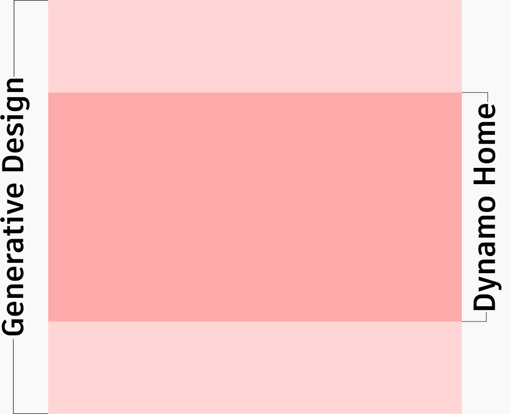

# Miniaturas de gráficos en Inicio de Dynamo

En Inicio de Dynamo, se muestran miniaturas de gráficos en una tarjeta ancha. Esta presenta un formato de 16:9. En Inicio, se centra la imagen y se recortan la parte superior y la inferior.

Una miniatura puede mostrarse totalmente en Diseño generativo, donde se muestra el cuadrado al completo. Es posible que, en Inicio, la misma imagen no muestre los títulos o los logotipos.

Esto se aplica a cualquier gráfico (`.dyn`), no solo a los que se encuentran dentro de un paquete. Establezca la imagen en las Propiedades de gráfico. La imagen se almacena en el archivo de gráficos.


Mantenga los títulos, los logotipos y la imagen principal en el **área segura** central. Utilice solo la parte superior e inferior de una miniatura cuadrada como fondo.


## Plantillas de miniaturas

Descargue una plantilla y diseñe sobre ella. La franja central más oscura es lo que se muestra en Inicio. Sin embargo, se recortan las franjas más claras de la parte superior e inferior. Diseño generativo muestra el cuadrado completo.

> Descargue la plantilla SVG para editarla en una aplicación vectorial o la plantilla PNG para insertar el diseño en un editor de imágenes.





<figure><figcaption>
La franja central más oscura se muestra en Inicio. Las franjas superior e inferior más claras se recortan.
</figcaption></figure>

## Creación de la miniatura

1. Abra la plantilla SVG o PNG en un editor de imágenes.
2. Coloque el diseño en el cuadrado rosa de la plantilla.
3. Mantenga el título, el logotipo y la imagen principal dentro de la franja central más oscura.
4. Utilice las franjas superior e inferior más claras solo como color de fondo o para añadir elementos decorativos adicionales.
5. Oculte o elimine la guía rosa y, a continuación, exporte un archivo PNG **cuadrado**.

Utilice una imagen **cuadrada** (1:1). En Inicio, la franja central más oscura siempre se muestra con un recorte de 16:9. El tamaño en píxeles no cambia el recorte. Si empieza con un archivo en blanco en lugar de utilizar la plantilla, asegúrese de que la imagen sea cuadrada. La plantilla de la miniatura tiene unas dimensiones de 840 × 840 píxeles.

## Adición de la miniatura a un gráfico

En Inicio, se lee la miniatura del archivo de gráficos (`.dyn`) y no del formulario de publicación de Package Manager.

1. Abra el gráfico en Dynamo.
2. Vaya a **Archivo > Mostrar propiedades de gráfico > General**.
3. Añada el archivo PNG exportado en el campo de imagen.
4. Guarde el gráfico.

Si el gráfico se encuentra en un paquete, incluya ese archivo `.dyn` al publicarlo. Consulte [Publicación de un paquete](../6_custom_nodes_and_packages/6-2_packages/4-publishing.md).

## Comprobación del resultado en Inicio

1. Abra Inicio de Dynamo.
2. En Recientes, busque el gráfico que acaba de guardar.
3. Compruebe que el título y el logotipo se vean perfectamente en la tarjeta.

Si el texto queda cortado, desplácelo hacia el centro, vuelva a exportar la imagen y actualice las Propiedades de gráfico. No confíe únicamente en Diseño generativo. Diseño generativo muestra el cuadrado completo.
